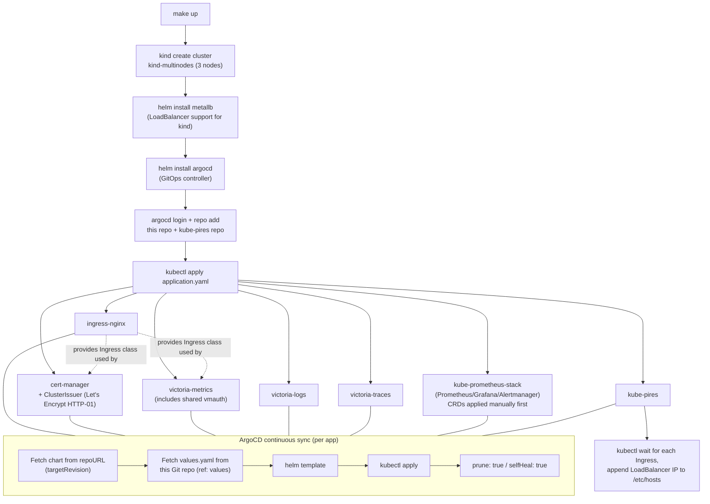
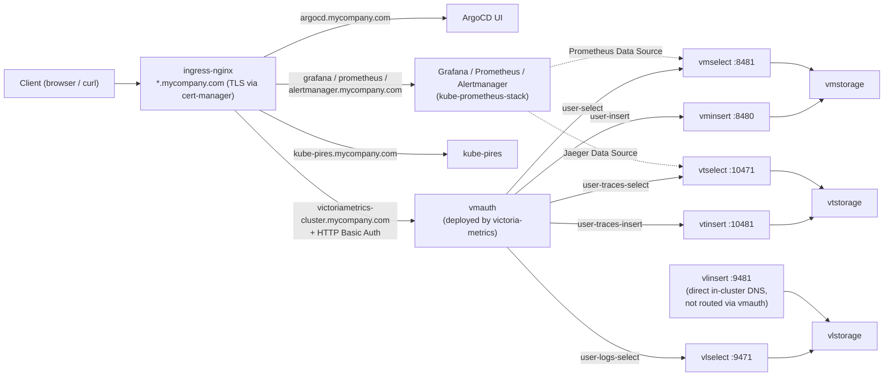

<!-- TOC -->

- [Contributing](#contributing)
  - [Repository structure](#repository-structure)
  - [Workflows](#workflows)
    - [Component installation workflow](#component-installation-workflow)
    - [Component communication workflow](#component-communication-workflow)
  - [Testing and upgrading software versions](#testing-and-upgrading-software-versions)
  - [Adding a new VictoriaMetrics-ecosystem Helm app (e.g. VictoriaTraces)](#adding-a-new-victoriametrics-ecosystem-helm-app-eg-victoriatraces)

<!-- TOC -->

# Contributing

- Configure authentication on your Github account to use the SSH protocol instead of HTTP. Watch this tutorial to learn how to set up: https://help.github.com/en/github/authenticating-to-github/adding-a-new-ssh-key-to-your-github-account
- [OPTIONAL] Install all packages and binaries following this [tutorial](REQUIREMENTS.md).

- Create a fork this repository.
- Clone the forked repository to your local system:

```bash
git clone FORKED_REPOSITORY
```

- Add the address for the remote original repository:

```bash
git remote -v
git remote add upstream git@github.com:aeciopires/learning-victoriametrics.git
git remote -v
```

- Configure your profile:

```bash
git config --local user.email "you@example.com"

git config --local user.name "Your Name"
```

- Create a branch. Example:

```bash
git checkout -b BRANCH_NAME
```

- Make sure you are on the correct branch using the following command. The branch in use contains the '*' before the name.

```bash
git branch
```

- Make your changes and tests to the new branch. See the next sections for more details about the structure of this repository, workflows and how to test your changes.

- Commit the changes to the branch.
- Push files to repository remote with command:

```bash
git push --set-upstream origin BRANCH_NAME
```

- Create Pull Request (PR) to the `main` branch. See this [tutorial](https://help.github.com/en/github/collaborating-with-issues-and-pull-requests/creating-a-pull-request-from-a-fork)
- Update the content with the suggestions of the reviewer (if necessary).
- After your pull request is merged to the `main` branch, update your local clone:

```bash
git checkout main
git pull upstream main
```

- Clean up after your pull request is merged with command:

```bash
git branch -d BRANCH_NAME
```

- Then you can update the ``main`` branch in your forked repository.

```bash
git push origin main
```

- And push the deletion of the feature branch to your GitHub repository with command:

```bash
git push --delete origin BRANCH_NAME
```

- To keep your fork in sync with the original repository, use these commands:

```bash
git pull upstream main
git push origin main
```

Reference:
- https://blog.scottlowe.org/2015/01/27/using-fork-branch-git-workflow/

## Repository structure

This repository holds no application source code. It is a GitOps configuration repo: `run.sh` bootstraps a local `kind` cluster and ArgoCD, then ArgoCD continuously syncs every other component straight from this Git repository.

```text
.
├── run.sh                       # Creates the kind cluster, installs MetalLB + ArgoCD via Helm,
│                                 # then applies every helm-apps/<app>/application.yaml via kubectl
├── Makefile                     # make up | make down | make recreate (wraps run.sh + requirement checks)
├── REQUIREMENTS.md              # Points to softwares-ubuntu.md / softwares-macos.md
├── softwares-ubuntu.md          # OS-level tool install instructions (asdf, kind, helm, kubectl, argocd-cli, cmctl, ...)
├── softwares-macos.md           # Same, for MacOS (PT-BR)
├── LEARNING_VICTORIAMETRICS.md  # Curated links used while studying VictoriaMetrics/VictoriaLogs
├── CHANGELOG.md                 # One heading per release, listing bumped component/chart versions
├── CONTRIBUTING.md              # This file
├── CLAUDE.md                    # Guidance for AI coding agents working in this repo
├── README.md                    # Entry point: use case, requirements, how to stand up the cluster
├── images/                      # Architecture diagrams and screenshots referenced from the READMEs
└── helm-apps/                   # One directory per Helm-based application, see structure below
    ├── argocd/                  # Installed directly via `helm upgrade --install` in run.sh (no application.yaml,
    │   └── values.yaml          # since ArgoCD itself can't deploy ArgoCD)
    ├── ingress-nginx/
    ├── cert-manager/
    ├── kube-prometheus-stack/   # Prometheus, Grafana, Alertmanager
    ├── victoriametrics-cluster-mode/  # vminsert / vmselect / vmstorage / vmauth (shared ingress)
    ├── victorialogs-cluster-mode/     # vlinsert / vlselect / vlstorage
    ├── victoriatraces-cluster-mode/   # vtinsert / vtselect / vtstorage
    └── kube-pires/              # Sample app deployed into the `myapps` namespace
```

Every `helm-apps/<app>/` directory (except `argocd/`, see above) follows the same three-file shape:

- `application.yaml` — the ArgoCD `Application` manifest. Declares two `sources`: the upstream Helm chart (`repoURL`/`chart`/`targetRevision`) and this Git repo as a second source (`ref: values`) supplying `helm-apps/<app>/values.yaml`. `syncPolicy.automated` sets `prune: true` / `selfHeal: true`, so ArgoCD continuously reconciles the live cluster to match what's committed here.
- `values.yaml` — Helm values passed to the upstream chart, normally generated from the chart's own defaults (`helm show values <chart> --version <version>`) and then trimmed/customized.
- `README.md` — architecture, access URLs, internal write/read API endpoints, and `kubectl` troubleshooting commands for that component.

## Workflows

### Component installation workflow

`run.sh` (invoked by `make up`) installs components in two phases: MetalLB and ArgoCD are installed directly via `helm upgrade --install`, and everything else is an ArgoCD `Application` applied via `kubectl`, which ArgoCD then syncs from this Git repo.



Because `values.yaml` is fetched from this Git repository (not the local working copy), any local edit only takes effect on the cluster once it is committed and pushed — `helm template` locally (or a direct `helm upgrade --install` against the same chart/values) is the fastest way to validate a change before pushing.

### Component communication workflow

VictoriaMetrics, VictoriaLogs and VictoriaTraces are intentionally exposed through a **single shared `vmauth`** (deployed only by `victoriametrics-cluster-mode`) behind **one** ingress hostname, `victoriametrics-cluster.mycompany.com`, differentiated by HTTP Basic Auth user — not one ingress hostname per product. Every other app (ArgoCD, Grafana/Prometheus/Alertmanager, kube-pires) gets its own ingress hostname/service directly.



Notes:
- `vlinsert` is reached directly at its internal `*.monitoring.svc.cluster.local` DNS name (e.g. by Vector log shippers running in-cluster) rather than through `vmauth`, since log ingestion doesn't need external Basic Auth in this homelab.
- Adding `user-<app>-insert`/`user-<app>-select` entries to `vmauth.config.users` in [helm-apps/victoriametrics-cluster-mode/values.yaml](helm-apps/victoriametrics-cluster-mode/values.yaml) is how every new VictoriaMetrics-ecosystem product (see the recipe below) gets wired into this shared communication path.
- `vmauth` only reads `-auth.config` once at startup unless `-configCheckInterval` is set; this repo sets it to `30s` so `vmauth.config.users` changes take effect without a manual pod restart.

## Testing and upgrading software versions

Every third-party component pinned in this repo (`kind` node image, MetalLB, ArgoCD, cert-manager, ingress-nginx, kube-prometheus-stack/Prometheus-Operator, and the VictoriaMetrics/VictoriaLogs/VictoriaTraces Helm charts) should be bumped and re-tested end-to-end on a local `kind-multinodes` cluster before opening a PR. Follow this sequence:

1. **Find the current pinned versions.**
   - `kind` node image: `KIND_CLUSTER_FILE` heredoc in [run.sh](run.sh) (`kindest/node:<tag>@sha256:<digest>`, repeated for each node).
   - `METALLB_CHART_VERSION`, `ARGOCD_CHART_VERSION`, `KUBE_PROMETHEUS_STACK_VERSION` (this last one is actually the Prometheus-Operator release tag used to fetch CRDs) at the top of [run.sh](run.sh).
   - `targetRevision` in each `helm-apps/<app>/application.yaml`.
   - Any explicit `image.tag` overrides inside `helm-apps/<app>/values.yaml` (e.g. `global.image.vm.tag` in [victoriametrics-cluster-mode/values.yaml](helm-apps/victoriametrics-cluster-mode/values.yaml), `common.image.tag` in [victorialogs-cluster-mode/values.yaml](helm-apps/victorialogs-cluster-mode/values.yaml)).
   - The chart image tag in [helm-apps/argocd/values.yaml](helm-apps/argocd/values.yaml) (`global.image.tag`).

2. **Look up the latest stable versions**, using the Helm repos already referenced by each `application.yaml`'s `repoURL`:

   ```bash
   helm repo add metallb https://metallb.github.io/metallb
   helm repo add argo https://argoproj.github.io/argo-helm
   helm repo add jetstack https://charts.jetstack.io
   helm repo add ingress-nginx https://kubernetes.github.io/ingress-nginx
   helm repo add prometheus-community https://prometheus-community.github.io/helm-charts
   helm repo add victoriametrics https://victoriametrics.github.io/helm-charts/
   helm repo update
   helm search repo <repo>/<chart> --versions | head -5
   ```

   For the Prometheus-Operator CRDs applied directly in `run.sh` (not via Helm), match the `appVersion` reported for `prometheus-community/kube-prometheus-stack` — the chart bundles that exact Prometheus-Operator release, and its CRDs must match.

3. **Update every location found in step 1** consistently (`run.sh` vars, each `application.yaml`'s `targetRevision`, and any explicit `image.tag` in `values.yaml`). Update the "Bump software versions" list in [CHANGELOG.md](CHANGELOG.md) under a new version heading.

4. **Test on a local `kind-multinodes` cluster:**

   ```bash
   make down     # remove any existing kind-multinodes cluster
   make up       # recreate the cluster and reinstall/sync every app via ArgoCD
   ```

   `make up` requires `sudo` (it edits `/etc/hosts`) and can take 20-40+ minutes depending on image pull speed, since most Helm releases install with `--wait --timeout=900s` and ArgoCD apps must reach `Synced`/`Healthy`.

5. **Verify the cluster came up healthy** before opening a PR:

   ```bash
   kubectl get applications -n argocd                     # every Application should be Synced + Healthy
   kubectl get pods -A | grep -v Running                  # no CrashLoopBackOff/Pending/Error
   helm list -A                                            # every release should be "deployed"
   ```

   Then exercise each ingress URL documented in the relevant `helm-apps/<app>/README.md` (ArgoCD, Grafana, Prometheus, Alertmanager, vmui, kube-pires) to confirm logins and dashboards still work after the bump.

6. **Tear down** with `make down` once satisfied, so the branch isn't tied to local cluster state.

## Adding a new VictoriaMetrics-ecosystem Helm app (e.g. VictoriaTraces)

New components from the VictoriaMetrics Helm charts repository (https://github.com/VictoriaMetrics/helm-charts) follow the same recipe used for `victoriametrics-cluster-mode`, `victorialogs-cluster-mode` and `victoriatraces-cluster-mode`:

1. Create `helm-apps/<new-app>/application.yaml`, copying an existing one (e.g. [helm-apps/victoriatraces-cluster-mode/application.yaml](helm-apps/victoriatraces-cluster-mode/application.yaml)) and adjusting `metadata.name`, `spec.destination.namespace`, `sources[0].chart` and `targetRevision`.
2. Generate a starting `values.yaml` from the chart's own defaults rather than writing one from scratch:

   ```bash
   helm repo add victoriametrics https://victoriametrics.github.io/helm-charts/
   helm repo update
   helm show values victoriametrics/<chart-name> --version <chart-version> > helm-apps/<new-app>/values.yaml
   ```

3. If the chart ships its own `vmauth`, keep it disabled (`vmauth.enabled: false`) and instead add `user-<app>-insert` / `user-<app>-select` entries to `vmauth.config.users` in [helm-apps/victoriametrics-cluster-mode/values.yaml](helm-apps/victoriametrics-cluster-mode/values.yaml), pointing at the new component's internal `*.monitoring.svc.cluster.local` DNS name. This repo intentionally exposes every VictoriaMetrics/VictoriaLogs/VictoriaTraces read/write path through the single shared vmauth ingress (`victoriametrics-cluster.mycompany.com`), differentiated by HTTP Basic Auth user, instead of one ingress hostname per component.
4. Set `nameOverride: ""` in the new `values.yaml` (rather than a chart-provided short name) so resource names follow the same `{release}-{chart}-{component}` pattern the vmauth `url_prefix` entries above depend on.
5. Add `kubectl -n argocd apply -f helm-apps/<new-app>/application.yaml` to [run.sh](run.sh), alongside the other `victoria*` apps.
6. Write `helm-apps/<new-app>/README.md` documenting the component architecture, the shared vmauth login, and internal write/read API DNS names/ports — follow the structure of [helm-apps/victoriatraces-cluster-mode/README.md](helm-apps/victoriatraces-cluster-mode/README.md).
7. Update the root [README.md](README.md) TOC/app list and [CLAUDE.md](CLAUDE.md), then run through the "Testing and upgrading software versions" steps above to validate the new app installs cleanly on `kind-multinodes`.
