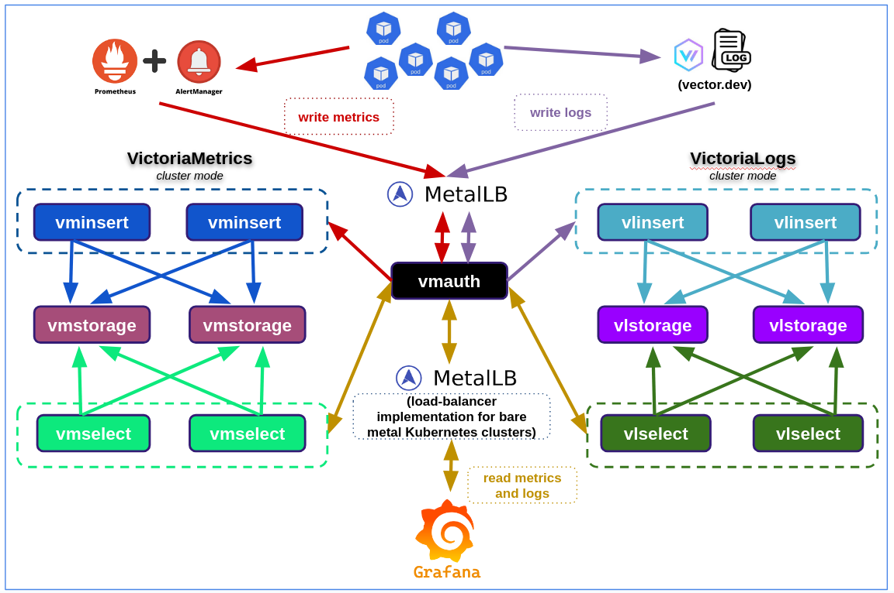
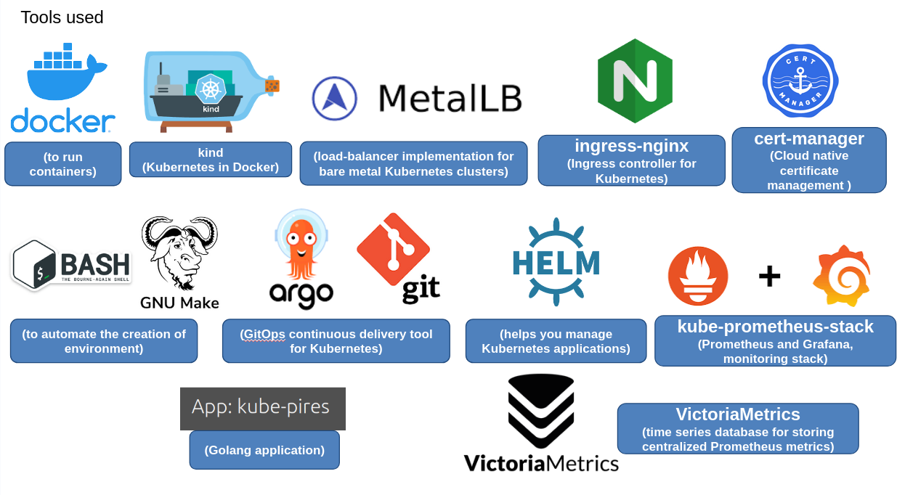
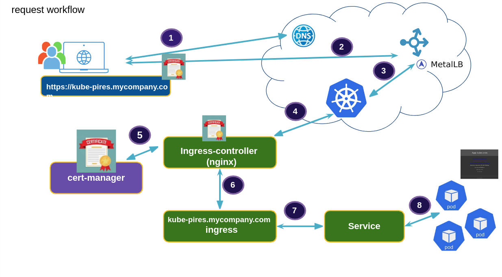

<!-- TOC -->

- [About](#about)
- [Use Case](#use-case)
- [Contributing](#contributing)
- [VictoriaMetrics documentation](#victoriametrics-documentation)
- [VictoriaStack](#victoriastack)
- [Requirements](#requirements)
- [Create cluster and deploy applications](#create-cluster-and-deploy-applications)
  - [Accessing the applications (Gateway API)](#accessing-the-applications-gateway-api)
  - [VictoriaMetrics Cluster Mode](#victoriametrics-cluster-mode)
  - [VictoriaLogs Cluster Mode](#victorialogs-cluster-mode)
  - [VictoriaTraces Cluster Mode](#victoriatraces-cluster-mode)
  - [argocd](#argocd)
  - [envoy-gateway](#envoy-gateway)
  - [gateway-api](#gateway-api)
  - [cert-manager](#cert-manager)
  - [metrics-server](#metrics-server)
  - [kube-prometheus-stack](#kube-prometheus-stack)
  - [kube-pires](#kube-pires)
- [VictoriaMetrics and VictoriaLogs Architecture](#victoriametrics-and-victorialogs-architecture)
- [Tools used](#tools-used)
- [Request workflow](#request-workflow)
- [Uninstall](#uninstall)
- [Maintainers](#maintainers)
- [License](#license)

<!-- TOC -->

# About

# Use Case

[VictoriaMetrics](https://victoriametrics.com) is a fast, cost-effective and scalable time series database. It can be used as a long-term remote storage for [Prometheus](https://prometheus.io/).

I worked at Sensedia for almost 5 years and used VIctoriaMetrics in production collecting metrics from over 100 clusters (EKS and GKE) running hundreds of pods on each cluster and going through 5 Black Friday without downtime in the monitoring stack.

Details of this use case can be found in the following links:

- [en-US] https://victoriametrics.com/case-studies/sensedia/ 
- [en-US] https://docs.victoriametrics.com/casestudies/#sensedia 
- [en-US] https://nordicapis.com/api-monitoring-with-prometheus-grafana-alertmanager-and-victoriametrics/ 
- [es] https://www.sensedia.com.es/post/seguimiento-con-prometheus-grafana-alertmanager-and-victoriametrics 
- [pt-BR] https://www.sensedia.com.br/post/monitoramento-de-aplicacoes-com-prometheus-grafana-alertmanager-e-victoriametrics
- [pt-BR] https://speakerdeck.com/aeciopires/monitoramento-de-aplicacoes-com-prometheus-grafana-alertmanager-e-victoriametrics 
- Slides (pt-BR): https://speakerdeck.com/aeciopires/monitoramento-de-aplicacoes-com-prometheus-grafana-alertmanager-e-victoriametrics 

I also contribute to the VictoriaMetrics helm chart:

- https://github.com/VictoriaMetrics/helm-charts 
- https://github.com/VictoriaMetrics/helm-charts/graphs/contributors

# Contributing

See [CONTRIBUTING.md](CONTRIBUTING.md) file.

# VictoriaMetrics documentation

See [LEARNING_VICTORIAMETRICS.md](LEARNING_VICTORIAMETRICS.md) file.

# VictoriaStack

[VictoriaStack](https://victoriametrics.com/products/victoriastack/) is the open source observability stack from VictoriaMetrics for **metrics, logs and traces**. It is not a single binary. It is a reference architecture that combines the VictoriaMetrics products, so you keep control over telemetry cost, retention and scaling on your own infrastructure.

Main building blocks:

| Layer | Components | Role |
|---|---|---|
| Storage | [VictoriaMetrics](https://docs.victoriametrics.com/victoriametrics/), [VictoriaLogs](https://docs.victoriametrics.com/victorialogs/), [VictoriaTraces](https://docs.victoriametrics.com/victoriatraces/) | One database per signal, each one single-node or cluster (`insert` / `select` / `storage`) with its own retention |
| Access | [vmauth](https://docs.victoriametrics.com/victoriametrics/vmauth/) | Authentication, routing, load balancing and multitenancy. The reference design uses one vmauth for writes (collectors) and another for reads (dashboards, alerting, AI clients) |
| Collection | [vmagent](https://docs.victoriametrics.com/victoriametrics/vmagent/), OpenTelemetry, Fluent Bit, Vector, Prometheus remote write | Ingestion, with stream aggregation and on-disk buffering during outages |
| Alerting | [vmalert](https://docs.victoriametrics.com/victoriametrics/vmalert/) + Alertmanager | Alerting and recording rules (Prometheus-compatible) |
| Visualization / AI | vmui, Grafana, Perses, MCP servers | Dashboards, cross-signal correlation and AI-assisted investigation |
| Kubernetes | [VictoriaMetrics Operator](https://docs.victoriametrics.com/operator/) and [Helm charts](https://github.com/VictoriaMetrics/helm-charts) | Manage databases, agents, vmauth and vmalert as Kubernetes resources |

How this homelab maps to VictoriaStack:

- **Already covered:** VictoriaMetrics, VictoriaLogs and VictoriaTraces in cluster mode, a vmauth that routes users to each product ([helm-apps/victoriametrics-cluster-mode/values.yaml](helm-apps/victoriametrics-cluster-mode/values.yaml)), Grafana with VictoriaMetrics and VictoriaLogs data sources, and Alertmanager.
- **Different on purpose:** collection and alerting use Prometheus from [kube-prometheus-stack](helm-apps/kube-prometheus-stack/README.md), which writes metrics to vminsert with `remoteWrite`. VictoriaStack uses vmagent and vmalert for this. There is a single shared vmauth for both reads and writes, not two. Everything is installed with Helm charts managed by ArgoCD, not with the operator.
- **Next steps to get closer to VictoriaStack:** replace Prometheus with vmagent and vmalert, split vmauth into write and read endpoints, send logs and traces through an OpenTelemetry Collector or Fluent Bit, or try the [VictoriaMetrics Operator](https://docs.victoriametrics.com/operator/).

References:

- Product page: https://victoriametrics.com/products/victoriastack/
- Documentation: https://docs.victoriametrics.com/victoriastack/
- Quick start: https://docs.victoriametrics.com/victoriastack/quick-start/
- Deployment guide: https://docs.victoriametrics.com/victoriastack/deployment/
- Source code: https://github.com/VictoriaMetrics/VictoriaStack

# Requirements

Install all packages and binaries following this [tutorial](REQUIREMENTS.md).

In short: Docker (Ubuntu 26.04, 24.04 or 22.04 LTS) or Colima + docker CLI (MacOS) and [mise](https://mise.jdx.dev) are installed manually. Every CLI used by this repository (``kind``, ``kubectl``, ``helm`` 4, ``argocd``, ``cmctl``, ``jq``) is pinned in [mise.toml](mise.toml), installed with ``mise install`` and executed by ``make`` through ``mise exec``.

# Create cluster and deploy applications

Create kind cluster and install helm apps using ``make`` command:

```bash
cd learning-victoriametrics
make up
```

Other targets: ``make help``, ``make requirements``, ``make tools`` (``mise install``), ``make helm-plugins``, ``make down`` and ``make recreate``.

Actions performed:

- Check the requirements installed outside of mise (``mise``, ``docker`` running, ``curl``, ``gpg``, ``sudo``)
- Install the tools of [mise.toml](mise.toml) with ``mise install`` and check that ``helm`` is version 4
- Run [run.sh](run.sh) with ``mise exec``, which performs the next steps
- Raise the inotify limits of the host if they are too low for kind (Linux only, with ``sudo``, until the next reboot). See [REQUIREMENTS.md](REQUIREMENTS.md#inotify-limits) to make it permanent (Ubuntu) or to set it in the Colima VM (MacOS)
- Create kind Kubernetes cluster
- Install MetalLB and ArgoCD with Helm
- Install with ArgoCD: Envoy Gateway (Gateway API), cert-manager, Gateway API resources (local CA, Gateway, HTTPRoutes), metrics-server, VictoriaMetrics (cluster mode), VictoriaLogs (cluster mode), VictoriaTraces (cluster mode), kube-prometheus-stack and kube-pires
- Insert new entries in /etc/hosts (Linux/MacOS) pointing to the address of the Gateway

## Accessing the applications (Gateway API)

All applications are exposed over HTTPS by a single [Gateway API](https://gateway-api.sigs.k8s.io/) `Gateway` implemented by [Envoy Gateway](https://gateway.envoyproxy.io/). Each application has its own `HTTPRoute`, HTTP is redirected to HTTPS and the TLS certificate (`*.mycompany.com`) is signed by a local CA managed by cert-manager.

| URL | Application |
|---|---|
| https://argocd.mycompany.com | ArgoCD |
| https://grafana.mycompany.com | Grafana |
| https://prometheus.mycompany.com | Prometheus |
| https://alertmanager.mycompany.com | Alertmanager |
| https://victoriametrics-cluster.mycompany.com | vmauth (VictoriaMetrics, VictoriaLogs and VictoriaTraces, with HTTP Basic Auth) |
| https://kube-pires.mycompany.com | kube-pires |

To avoid browser certificate warnings, trust the local CA:

```bash
kubectl -n cert-manager get secret mycompany-local-ca -o jsonpath='{.data.ca\.crt}' | base64 -d > mycompany-local-ca.crt
```

See [helm-apps/gateway-api/README.md](helm-apps/gateway-api/README.md) for the architecture, the Gateway API features used, how to trust the CA in the operating system and troubleshooting.

## VictoriaMetrics Cluster Mode

See the [helm-apps/victoriametrics-cluster-mode/README.md](helm-apps/victoriametrics-cluster-mode/README.md) file to configure VictoriaMetrics cluster mode.

## VictoriaLogs Cluster Mode

See the [helm-apps/victorialogs-cluster-mode/README.md](helm-apps/victorialogs-cluster-mode/README.md) file to configure VictoriaLogs cluster mode.

## VictoriaTraces Cluster Mode

See the [helm-apps/victoriatraces-cluster-mode/README.md](helm-apps/victoriatraces-cluster-mode/README.md) file to configure VictoriaTraces cluster mode.

## argocd

See the [helm-apps/argocd/README.md](helm-apps/argocd/README.md)

## envoy-gateway

See the [helm-apps/envoy-gateway/README.md](helm-apps/envoy-gateway/README.md)

## gateway-api

See the [helm-apps/gateway-api/README.md](helm-apps/gateway-api/README.md)

## cert-manager

See the [helm-apps/cert-manager/README.md](helm-apps/cert-manager/README.md)

## metrics-server

See the [helm-apps/metrics-server/README.md](helm-apps/metrics-server/README.md)

## kube-prometheus-stack

See the [helm-apps/kube-prometheus-stack/README.md](helm-apps/kube-prometheus-stack/README.md)

## kube-pires

See the [helm-apps/kube-pires/README.md](helm-apps/kube-pires/README.md)

# VictoriaMetrics and VictoriaLogs Architecture



# Tools used



> **NOTE:** the images in this section and in [Request workflow](#request-workflow) still show ingress-nginx. Since version 1.4.0, the requests enter the cluster through the Envoy Gateway (Gateway API) and the TLS certificate comes from a local CA. See the updated diagram in [helm-apps/gateway-api/README.md](helm-apps/gateway-api/README.md#how-the-applications-are-exposed).

# Request workflow



# Uninstall

Destroy Kind cluster and uninstall apps:

```bash
cd learning-victoriametrics
make down
```

# Maintainers

- Aécio dos Santos Pires [https://linktree.com/aeciopires](https://linktree.com/aeciopires)

# License

GPL-3.0 Aécio dos Santos Pires
