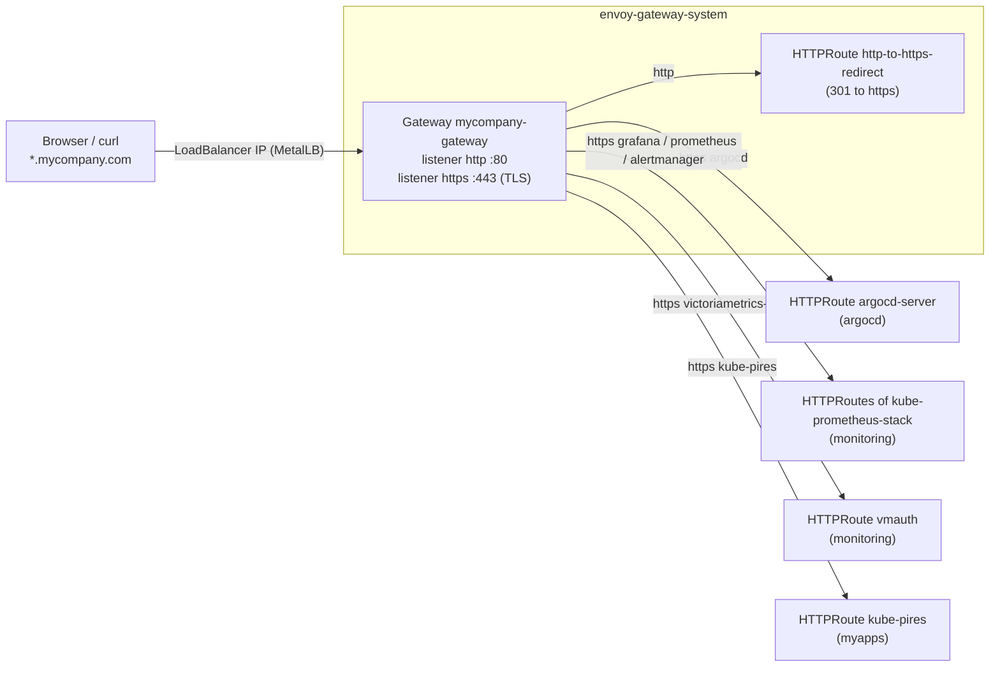

# gateway-api

<!-- TOC -->

- [gateway-api](#gateway-api)
- [Requirements](#requirements)
- [How the applications are exposed](#how-the-applications-are-exposed)
  - [Resources](#resources)
  - [HTTPRoutes of the applications](#httproutes-of-the-applications)
  - [Gateway API features used](#gateway-api-features-used)
- [TLS with a local CA](#tls-with-a-local-ca)
  - [Trust the local CA](#trust-the-local-ca)
  - [Let's Encrypt](#lets-encrypt)
- [DNS](#dns)
- [Adding a new application](#adding-a-new-application)
- [Troubleshooting](#troubleshooting)
- [References](#references)

<!-- TOC -->

This ArgoCD application (plain manifests in [manifests](manifests), no Helm chart) declares the [Gateway API](https://gateway-api.sigs.k8s.io/) resources that expose every application of this lab through [Envoy Gateway](../envoy-gateway/README.md). It replaces the ingress-nginx controller used by previous versions.

# Requirements

- Install all packages and binaries following the instructions on the [REQUIREMENTS.md](../../REQUIREMENTS.md) file.
- Create the cluster following the instructions on the [README.md](../../README.md#create-cluster-and-deploy-applications) file.
- The [envoy-gateway](../envoy-gateway/README.md) app (Gateway API CRDs + controller) and the [cert-manager](../cert-manager/README.md) app (with `config.gatewayAPI.enabled: true`) must be installed first. ``run.sh`` follows this order.

# How the applications are exposed



## Resources

| File | Resource | Purpose |
|---|---|---|
| [01-local-ca.yaml](manifests/01-local-ca.yaml) | `ClusterIssuer/selfsigned-bootstrap`, `Certificate/mycompany-local-ca` (namespace `cert-manager`), `ClusterIssuer/mycompany-local-ca` | Local CA used to sign the certificates of the Gateway |
| [02-gateway.yaml](manifests/02-gateway.yaml) | `GatewayClass/envoy-gateway`, `Gateway/mycompany-gateway` (namespace `envoy-gateway-system`) | Entry point. Envoy Gateway creates an Envoy proxy Deployment and a `LoadBalancer` Service (IP from MetalLB) for it |
| [03-http-redirect.yaml](manifests/03-http-redirect.yaml) | `HTTPRoute/http-to-https-redirect` | Redirects HTTP to HTTPS |
| [04-argocd-httproute.yaml](manifests/04-argocd-httproute.yaml) | `HTTPRoute/argocd-server` (namespace `argocd`) | ArgoCD UI/API. Declared here because ArgoCD is installed before the Gateway API CRDs exist |

The manifests use `argocd.argoproj.io/sync-wave` annotations, so the CA is ready before the CA issuer and the Gateway are created.

## HTTPRoutes of the applications

Each application declares its own `HTTPRoute` in its own namespace, attached to the `https` listener of the Gateway:

| Hostname | HTTPRoute | Declared in |
|---|---|---|
| argocd.mycompany.com | `argocd/argocd-server` | [manifests/04-argocd-httproute.yaml](manifests/04-argocd-httproute.yaml) |
| grafana.mycompany.com | `monitoring/monitor-grafana` | `grafana.route.main` in [kube-prometheus-stack/values.yaml](../kube-prometheus-stack/values.yaml) |
| prometheus.mycompany.com | `monitoring/monitor-mycompany-prometheus` | `prometheus.route.main` in [kube-prometheus-stack/values.yaml](../kube-prometheus-stack/values.yaml) |
| alertmanager.mycompany.com | `monitoring/monitor-mycompany-alertmanager` | `alertmanager.route.main` in [kube-prometheus-stack/values.yaml](../kube-prometheus-stack/values.yaml) |
| victoriametrics-cluster.mycompany.com | `monitoring/victoria-metrics-victoria-metrics-cluster-vmauth` | `vmauth.route` in [victoriametrics-cluster-mode/values.yaml](../victoriametrics-cluster-mode/values.yaml) |
| kube-pires.mycompany.com | `myapps/kube-pires` | `extraManifests` in [kube-pires/values.yaml](../kube-pires/values.yaml) (the chart has no HTTPRoute template) |

VictoriaLogs and VictoriaTraces have no hostname of their own: they are reached through the vmauth of VictoriaMetrics (see [victoriametrics-cluster-mode/README.md](../victoriametrics-cluster-mode/README.md)).

## Gateway API features used

- **Role separation**: the cluster operator owns the `GatewayClass` and the `Gateway` (this app), and each application team owns the `HTTPRoute` of its application, in its own namespace.
- **Hostname routing** with a wildcard listener (`*.mycompany.com`) and per-application `hostnames`.
- **TLS termination** at the Gateway (`tls.mode: Terminate`), with the certificate issued by cert-manager from the Gateway annotation `cert-manager.io/cluster-issuer` (gateway-shim).
- **HTTP to HTTPS redirect** with the `RequestRedirect` filter.
- **Cross-namespace attachment control**: the `https` listener only accepts `HTTPRoute`s from the `argocd`, `monitoring` and `myapps` namespaces (`allowedRoutes.namespaces.from: Selector`), and the `http` listener only accepts routes from its own namespace.
- **Status conditions**: `Gateway` (`Programmed`, listener `ResolvedRefs`) and `HTTPRoute` (`Accepted`, `ResolvedRefs`) report whether the configuration was applied. ``run.sh`` waits for them.
- **Gateway address**: the IP written to `/etc/hosts` is read from `Gateway.status.addresses`.

# TLS with a local CA

Let's Encrypt can't validate a private domain (`mycompany.com`) running inside kind, so this lab uses a local CA managed by cert-manager:

1. `ClusterIssuer/selfsigned-bootstrap` signs the CA certificate `Certificate/mycompany-local-ca` (secret `mycompany-local-ca` in the `cert-manager` namespace).
2. `ClusterIssuer/mycompany-local-ca` signs certificates with this CA.
3. cert-manager sees the annotation `cert-manager.io/cluster-issuer: mycompany-local-ca` on the Gateway and creates the `Certificate/wildcard-mycompany-com-tls` (`*.mycompany.com`) referenced by the `https` listener.

## Trust the local CA

Export the CA certificate:

```bash
kubectl -n cert-manager get secret mycompany-local-ca -o jsonpath='{.data.ca\.crt}' | base64 -d > mycompany-local-ca.crt
```

Use it with ``curl``:

```bash
curl --cacert mycompany-local-ca.crt https://grafana.mycompany.com/
```

Or trust it in the operating system, to avoid browser warnings:

```bash
# Ubuntu
sudo cp mycompany-local-ca.crt /usr/local/share/ca-certificates/mycompany-local-ca.crt
sudo update-ca-certificates

# MacOS
sudo security add-trusted-cert -d -r trustRoot -k /Library/Keychains/System.keychain mycompany-local-ca.crt
```

> The CA is recreated every time the cluster is recreated, so trust the new one after ``make recreate``. Some browsers (e.g. Firefox) use their own certificate store.

## Let's Encrypt

``run.sh`` also creates the `ClusterIssuer/letsencrypt-prod-http01`, with the HTTP-01 challenge solved through this Gateway (`gatewayHTTPRoute` solver). It's only an example for a cluster with a public domain, a public IP and a valid email: in this lab it stays `Ready=False`. To use it, change the annotation `cert-manager.io/cluster-issuer` of the Gateway to `letsencrypt-prod-http01` and use one HTTPS listener per hostname (HTTP-01 doesn't issue wildcard certificates).

# DNS

All hostnames point to the address of the Gateway. ``run.sh`` adds them to ``/etc/hosts``. To do it manually:

> ATTENTION!!! You must be connected to the kind cluster

```bash
export IP=$(kubectl get gateway mycompany-gateway -n envoy-gateway-system -o jsonpath='{.status.addresses[0].value}')
for DNS in argocd grafana prometheus alertmanager kube-pires victoriametrics-cluster; do
  sudo grep -qxF "$IP  $DNS.mycompany.com" /etc/hosts || sudo sh -c "echo '$IP  $DNS.mycompany.com' >> /etc/hosts"
done
```

# Adding a new application

1. Make sure the namespace of the application is listed in `allowedRoutes` of the `https` listener in [02-gateway.yaml](manifests/02-gateway.yaml).
2. Enable the HTTPRoute of the chart (usually `route` or `httproute` in the values) or declare one, with:

```yaml
parentRefs:
  - name: mycompany-gateway
    namespace: envoy-gateway-system
    sectionName: https
hostnames:
  - myapp.mycompany.com
```

3. Add the hostname to ``/etc/hosts`` (see [DNS](#dns)) and to ``run.sh``.

# Troubleshooting

```bash
# Gateway status, address and listeners
kubectl get gatewayclass
kubectl get gateway -n envoy-gateway-system
kubectl describe gateway mycompany-gateway -n envoy-gateway-system

# Routes and their status (Accepted / ResolvedRefs)
kubectl get httproute -A
kubectl describe httproute monitor-grafana -n monitoring

# Certificates
kubectl get clusterissuer
kubectl get certificate -A

# Envoy proxy (data plane) created for the Gateway
kubectl get pods,svc -n envoy-gateway-system -l gateway.envoyproxy.io/owning-gateway-name=mycompany-gateway

# Test a route without /etc/hosts
export IP=$(kubectl get gateway mycompany-gateway -n envoy-gateway-system -o jsonpath='{.status.addresses[0].value}')
curl -v --cacert mycompany-local-ca.crt --resolve grafana.mycompany.com:443:$IP https://grafana.mycompany.com/
```

# References

- https://gateway-api.sigs.k8s.io/
- https://gateway-api.sigs.k8s.io/guides/http-redirect-rewrite/
- https://gateway.envoyproxy.io/docs/
- https://cert-manager.io/docs/usage/gateway/
- https://cert-manager.io/docs/configuration/ca/
- https://cert-manager.io/docs/configuration/acme/http01/#configuring-the-http-01-gateway-api-solver
