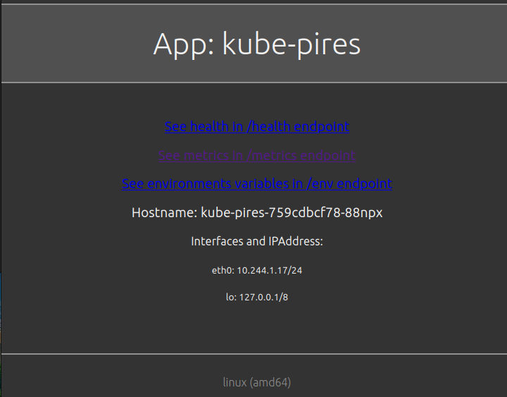

# install-kube-pires

<!-- TOC -->

- [install-kube-pires](#install-kube-pires)
- [Requirements](#requirements)
- [DNS](#dns)
- [References](#references)

<!-- TOC -->

# Requirements

- Install all packages and binaries following the instructions on the [REQUIREMENTS.md](../../REQUIREMENTS.md) file.
- Create the cluster following the instructions on the [README.md](../../README.md#create-cluster-and-deploy-applications) file.

# DNS

If needs add entry in ``/etc/hosts`` file (every hostname points to the address of the Envoy Gateway, see [gateway-api](../gateway-api/README.md)):

> ATTENTION!!! You must be connected to the kind cluster

```bash
# Add entry in /etc/hosts for kube-pires
export IP=$(kubectl get gateway mycompany-gateway -n envoy-gateway-system -o jsonpath='{.status.addresses[0].value}')
sudo grep -qxF "$IP  kube-pires.mycompany.com" /etc/hosts || sudo sh -c "echo '$IP  kube-pires.mycompany.com' >> /etc/hosts"
```

Open the browser and access the URL: https://kube-pires.mycompany.com/



``kube-pires`` is a web application developed using Golang.
It's show the follow informations of the pods:


- ``/``        => Show the hostname, network interfaces and IP addresses, OS/architecture, version and trace ID;
- ``/livez``   => Liveness: the process is alive (used by the liveness probe);
- ``/readyz``  => Readiness: ``200`` when it can receive requests, ``503`` while shutting down (used by the readiness probe);
- ``/health``  => Original health check, always ``200`` (kept for compatibility);
- ``/metrics`` => Show the metrics in supported format by prometheus;
- ``/env``     => Show the environment variables (**sensitive**);
- ``/css``     => Show the CSS template;

# References

- https://gitlab.com/aeciopires/kube-pires